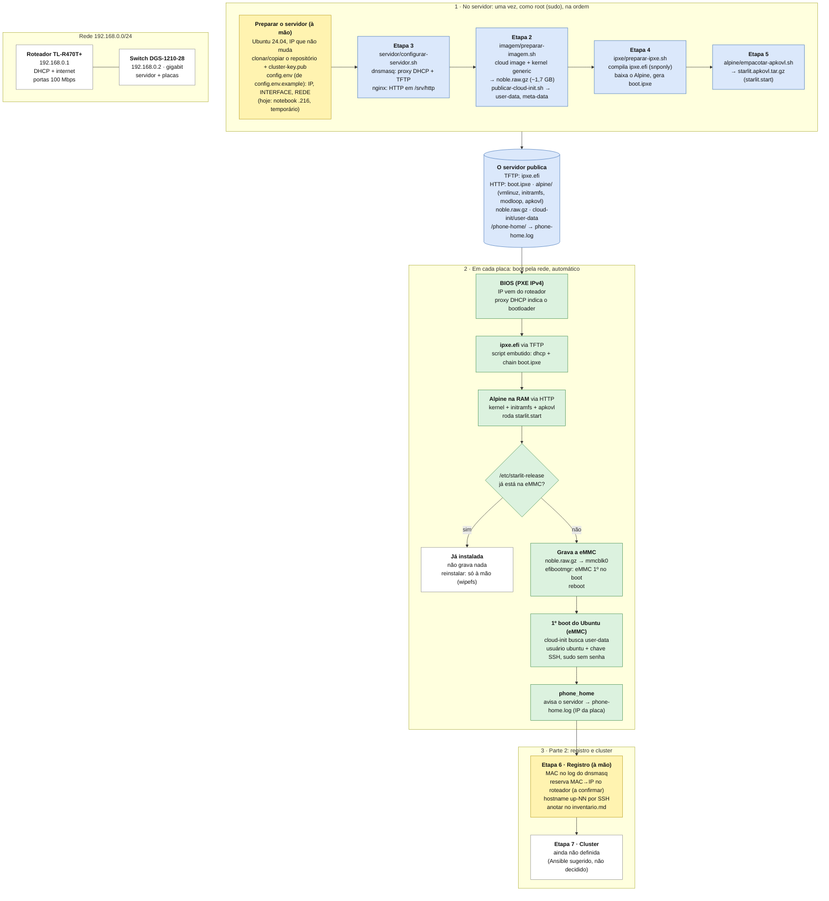

# Arquitetura do provisionamento

Visão geral do processo: da preparação do servidor até a última etapa definida nas [etapas](etapas/index.md).

Cores: azul = roda no servidor; verde = roda na placa; amarelo = passo manual; branco = pendente ou rede.

